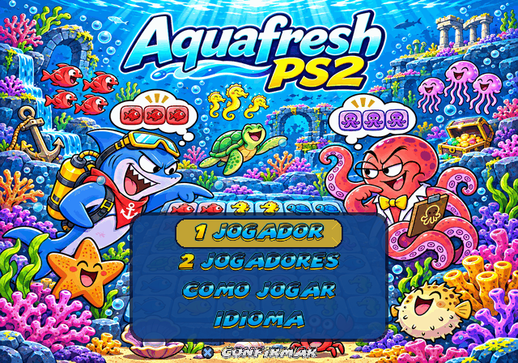
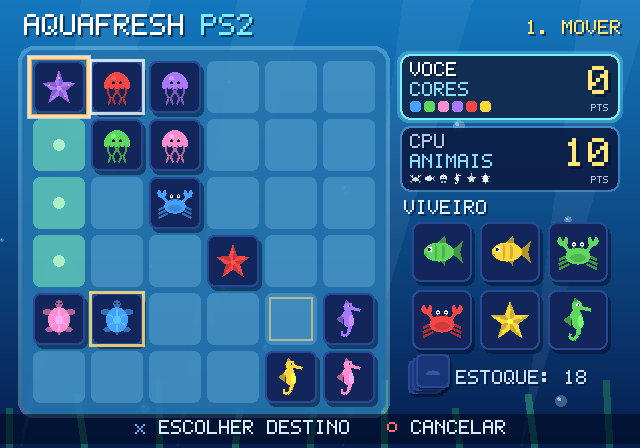
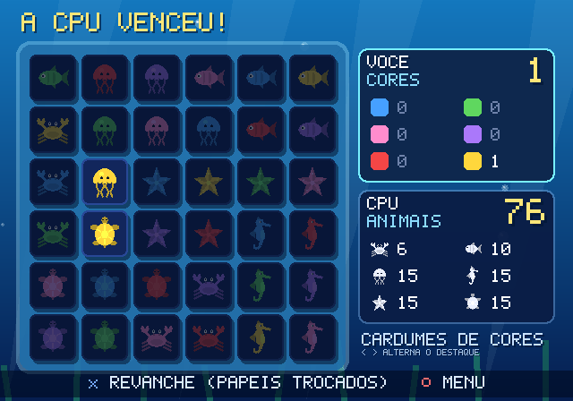

# Aquafresh PS2

Jogo de estratégia para 2 jogadores (ou contra a CPU) para **PlayStation 2**,
baseado nas regras de cardumes do recife: um jogador forma cardumes da **mesma
cor**, o outro cardumes do **mesmo animal**. Ganha quem tiver mais pontos quando
o recife 6x6 estiver cheio.





## Como jogar

**Material:** recife 6x6 e 36 criaturas (6 cores × 6 animais: caranguejo, peixe,
água-viva, cavalo-marinho, estrela-do-mar e tartaruga). No começo, 6 criaturas
aleatórias vão para o **viveiro**; as outras 30 ficam no **estoque**.

**Turno** (3 fases):
1. **Mover (opcional)** – deslize *uma* criatura do recife em linha ou coluna,
   quantas casas quiser, sem pular outras criaturas. Não existe no 1º turno.
   Qualquer jogador pode mover qualquer criatura.
2. **Colocar** – escolha uma criatura do viveiro e coloque-a em qualquer casa vazia.
3. **Repor** – uma criatura do estoque vai para o viveiro (automático).

**Pontuação:** cardume = 2 ou mais criaturas vizinhas *lado a lado* (diagonal
não conta) com a mesma cor (jogador CORES) ou o mesmo animal (jogador ANIMAIS).

| Criaturas no cardume | 2 | 3 | 4 | 5 | 6 |
|---|---|---|---|---|---|
| Pontos | 1 | 3 | 6 | 10 | 15 |

Uma criatura sozinha não vale nada. **Empate: vence quem jogou em segundo.**
Na **revanche** os papéis são trocados.

## Controles (DualShock 2)

| Botão | Ação |
|---|---|
| Direcional / analógico esquerdo | Mover cursor |
| ✕ | Confirmar |
| ○ | Voltar / cancelar (desfaz o movimento antes de colocar) |
| SELECT | Liga/desliga a música |
| △ | Pular a fase de movimento |
| L1 / R1 | Trocar a criatura escolhida do viveiro |
| START | Pausa |

No modo 2 jogadores, os dois controles funcionam (ou passem o mesmo controle).
Na tela final, o direcional alterna o destaque entre os cardumes de cada jogador.

## Som

Trilha e efeitos originais com tema de recife de corais, sintetizados por
`tools/gen_audio.py` (marimba, steel drum, pads, baixo, chocalho, congas,
bolhas e ondas — nenhum sample externo):

- **Festa no Recife** (menus) – calipso em Dó maior, 112 BPM.
- **Recife Calmo** (partida) – Fá maior, 92 BPM, com ondas ao fundo.
- Efeitos: cursor (bolha), confirmar/voltar (marimba), deslizar criatura
  (água), colocar (plop), cardume formado (arpejo de steel drum), erro, sua vez
  (sininhos de concha), início de partida, vitória e derrota.

Ouça em [`audio_preview/`](audio_preview). No jogo: **SELECT** liga/desliga a
música; no menu de pausa dá para desligar música e efeitos separadamente.

No PS2, `src/audio.c` mistura música e até 8 efeitos (com pan estéreo pela
posição no recife) a 48 kHz e uma thread envia o áudio ao `audsrv.irx`.

## Idiomas

Ao ligar, o jogo pergunta o idioma: **Português** (padrão), **English** ou
**Español**. Dá para trocar depois no menu principal (IDIOMA / LANGUAGE).
Os textos ficam em `src/lang.c`.

## Modos

- **1 Jogador** contra a CPU – escolha seu papel (cores/animais), dificuldade
  (Fácil, Normal, Difícil) e quem começa.
- **2 Jogadores** no mesmo console.
- **Como jogar** – regras dentro do jogo.

## Rodando

Baixe a última versão em **Releases** do repositório (`AquafreshPS2.elf` e
`AquafreshPS2.iso`, compilados pelo GitHub Actions sempre que o arquivo `VERSION` muda) ou use os
arquivos em [`dist/`](dist):

- `AquafreshPS2.iso` – imagem de disco (PCSX2 ou Open PS2 Loader).
- `AQUAFRESH.ELF` – executável (PCSX2: *Sistema → Iniciar ELF*; PS2 real:
  uLaunchELF / FreeMcBoot a partir de um pendrive).

## Compilando

O código é C puro com [PS2SDK](https://github.com/ps2dev/ps2sdk) + gsKit.

### Gráficos

A arte fica em `assets/src/` (`sprites.png` com as 36 peças, personagens e
decorações; `font.png` com a fonte; `title.png` com a tela de título).
`make assets` (Python + Pillow, numpy, scipy) gera também os sons, recorta tudo, remove o fundo
branco e gera atlas de textura de 8 bits com paleta (T8 + CLUT) em
`assets/bin/`, que são embutidos no executável. Com 8 bits por pixel, todas as
texturas da partida (~0,9 MB) cabem juntas na VRAM de 4 MB do PS2.

```sh
# Com Docker (imagem oficial ps2dev):
make docker            # gera aquafresh.elf, aquafresh-packed.elf e aquafresh.iso

# Com o PS2SDK instalado (variáveis PS2DEV/PS2SDK/GSKIT definidas):
make && make packed && make iso

# No PC, sem PS2SDK:
make test              # testa as regras e a IA
make shots             # gera capturas de tela em screenshots/
```

O GitHub Actions (`.github/workflows/build.yml`) também compila e publica o
ELF e a ISO como artefatos.

## Estrutura

| Arquivo | Conteúdo |
|---|---|
| `src/game.c` | Regras, pontuação e IA (independente de plataforma) |
| `src/ui.c` | Telas, menus e fluxo da partida |
| `src/draw.c` | Formas, texto e desenho das criaturas |
| `src/assets.c`, `src/assets_bin.S` | Tabela de sprites e texturas embutidas (gerados por `tools/gen_assets.py`) |
| `src/font.c` | Fonte bitmap 5x7 para textos bem pequenos (gerada por `tools/gen_font.py`) |
| `src/audio.c` | Mixer de música e efeitos (sons gerados por `tools/gen_audio.py`) |
| `src/main_ps2.c` | Vídeo (gsKit), controle (libpad) e áudio (audsrv) do PS2 |
| `host/host_main.c` | Rasterizador em software para testar/capturar telas no PC |
| `tests/test_game.c` | Testes das regras |
